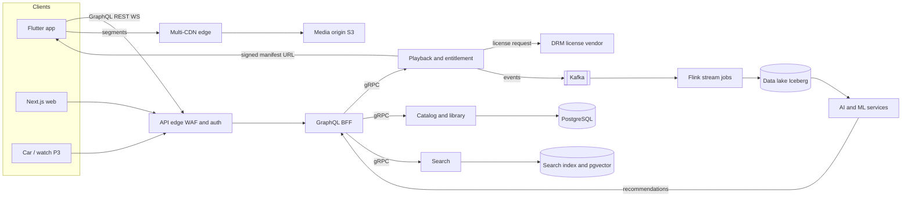

# 2. System Architecture — AuraSound

**Status:** Draft v1.0 · **Companion docs:** [01-prd](01-prd.md), [03-data-model-and-api](03-data-model-and-api.md), [05-ai-ml-pipeline](05-ai-ml-pipeline.md)

---

## 2.1 Decisions at a glance

| # | Decision | Choice | Why (short) | Reversibility |
|---|---|---|---|---|
| ADR-01 | Mobile framework | **Flutter** (Android, iOS, later desktop) | One UI codebase with consistent rendering and animation performance; mature audio plugin (just_audio) on ExoPlayer and AVPlayer; team can own the full stack in one language | Medium. The `player/` module sits behind an interface, so the engine is replaceable |
| ADR-02 | Web | **Next.js** (React, TypeScript) | Server-rendered artist, album, and playlist pages for SEO and link previews; code sharing with TypeScript BFF | High |
| ADR-03 | Native modules | Kotlin (Android Auto, Wear OS) and Swift (CarPlay, watchOS) | Car and watch platforms require native templates and APIs | — |
| ADR-04 | Backend services | **Go** for latency-critical services; **TypeScript (Node)** for the GraphQL BFF | Go for playback, catalog, and gateways (low latency, low memory); TypeScript for BFF to share types with web | Medium |
| ADR-05 | ML and data | **Python** (PyTorch, Ray, Airflow/Dagster) | Industry standard; largest talent pool; Indic-language models are Python-first | High |
| ADR-06 | API style | GraphQL (BFF) for screens, REST for commands, gRPC inside, WebSocket for rooms, SSE for AI streaming | Each protocol matches its use; see §2.6 | Medium |
| ADR-07 | Primary cloud | **AWS, Mumbai (ap-south-1)** primary; EU region added in Phase 2 | Indian latency and data residency; mature media services (MediaConvert, CloudFront, S3) | Medium |
| ADR-08 | Streaming format | **CMAF** (fMP4) segments with HLS and DASH manifests; AAC and Opus for standard, FLAC for Hi-Res; CENC encryption | One set of media segments serves all clients and DRM systems | High |
| ADR-09 | Vector search | **pgvector** in MVP; dedicated vector engine above ~50M vectors or 2k QPS | Fewer moving parts while the catalog is small; clear migration trigger | High |
| ADR-10 | Event backbone | **Kafka-compatible** streaming (Amazon MSK) | Durable log for listening events, fan-out to recs, royalties, analytics | Medium |
| ADR-11 | Recommendations | Hybrid: two-tower retrieval + ranking model + rules | Balances cold start (content) and accuracy (behaviour); see [05](05-ai-ml-pipeline.md) | High |
| ADR-12 | Generative AI | Only licensed or consented models and data; LLM through a gateway that can switch providers | Legal risk ([08-risks.md](08-risks.md), R-3) and vendor independence | Medium |

---

## 2.2 Platform choice: Flutter vs React Native vs native

The question is which cross-platform stack gives the best outcome for a media-heavy app with a premium UI, a small-to-medium team, and a web product alongside it.

| Criterion (weight) | Flutter | React Native (New Architecture) | Fully native (Kotlin + Swift) |
|---|---|---|---|
| Audio playback control (20%) | Good. just_audio wraps ExoPlayer and AVPlayer; gapless works via concatenation. Background audio needs audio_service | Good. react-native-track-player wraps the same native players; comparable capability | Best. Direct access to Media3 and AVFoundation |
| Animation and UI performance (15%) | Strong. Skia/Impeller renders the same pixels on both platforms; smooth 120 Hz | Good with Reanimated and Fabric; platform-specific differences in list and text rendering | Best per platform, but two UI codebases |
| Native integrations: Auto, CarPlay, Wear, watch (15%) | Requires native modules for each car and watch surface | Same requirement; the native module ecosystem is larger | Native by default |
| Code sharing with web (10%) | Low. Flutter web is not suited to SEO-led pages; logic is not shared with Next.js | High. TypeScript types, validation, and some logic can be shared with Next.js | Low |
| Talent availability in India (15%) | Good and growing; smaller pool than JS | Largest pool (JavaScript and TypeScript) | Large, but two pools |
| Team velocity and single source of truth (15%) | One language, one design system, one test stack | Two languages (JS and native bridges), more dependency churn | Two codebases; highest cost |
| Long-term maintenance risk (10%) | Google-backed; some plugin maintenance risk for media plugins | Meta-backed; New Architecture transition mostly complete | Lowest platform risk; highest cost |

**Recommendation: Flutter** for the Android, iOS, and desktop apps. Reasons:

1. The app's hardest parts are audio, offline storage, and DRM. These are done in native code under the plugin layer in both options. The UI choice therefore matters most for consistency and animation quality, where Flutter is strongest.
2. Desktop companion and tablets come from the same code.
3. One team owns the mobile UI, which removes the bridge-coordination cost of React Native and native modules.

**What would change the decision:** if the web player must share most components with the mobile app, or if the team already has strong React Native experience, React Native becomes the better choice. The API-first design (§2.6) and the isolated `player/` module keep this choice reversible for the first six months.

**Spike before commit (Month 1):** background playback with lock-screen controls, DRM license acquisition with Widevine and FairPlay, gapless transitions on low-end Android, and offline encrypted files. Pass criteria are in [06-roadmap-and-team.md](06-roadmap-and-team.md).

### Backend language choice

| Option | Strengths | Weaknesses | Use for |
|---|---|---|---|
| **Go** | Low latency, small memory footprint, strong concurrency, simple deployment | Less expressive for complex domain logic; smaller pool than Node in India | Playback and entitlement, catalog read, gateway, royalty ledger |
| **TypeScript / Node** | Shared types with web and mobile, large talent pool, fast iteration | Higher tail latency under load; GC pauses | GraphQL BFF, creator tools, admin tools |
| **Python** | ML ecosystem, data tooling | Not for hot request paths | ML serving (behind gRPC), pipelines, data services |
| Java or Kotlin | Mature enterprise ecosystem | Heavier to run and hire for at this scale | Not chosen |

---

## 2.3 System diagram

Clients, edges, services, data, and AI, in layers:

```
┌──────────────────────────── CLIENTS ─────────────────────────────────────────────┐
│ Flutter app (Android, iOS; desktop P3)   Next.js web player   Android Auto /     │
│                                          CarPlay / Wear OS / watchOS (P3)       │
└──────────┬──────────────────────────────────────────┬────────────────────────────┘
           │ media segments (HTTPS, CMAF, encrypted)   │ API: GraphQL, REST, WS, SSE
┌──────────▼──────────────────────┐      ┌────────────▼────────────────────────────┐
│ MULTI-CDN EDGE                  │      │ API EDGE                                 │
│ CloudFront + second CDN (P2)    │      │ WAF, DDoS, rate limits, OIDC/JWT check   │
│ Signed URLs, token auth         │      │ Device attestation (Play Integrity, App  │
│ Segment cache, ABR-friendly     │      │ Attest)                                  │
└──────────┬──────────────────────┘      └────────────┬────────────────────────────┘
           │ origin fetch                              │
┌──────────▼──────────────────────┐      ┌────────────▼────────────────────────────┐
│ MEDIA ORIGIN (S3)               │      │ GraphQL BFF (TypeScript)                 │
│ CMAF renditions, manifests      │      │ Screen-shaped queries: home, search,     │
│ Encrypted at rest (SSE-KMS)     │      │ album, artist, now-playing               │
└──────────▲──────────────────────┘      └────────────┬────────────────────────────┘
           │ write                                     │ gRPC (mTLS service mesh)
┌──────────┴──────────────────────┐   ┌───────────────▼────────────────────────────────────────┐
│ MEDIA PIPELINE                  │   │ DOMAIN SERVICES (Go unless noted)                      │
│ Ingest → loudness (EBU R128) →  │   │ identity · entitlement+playback · catalog · library ·  │
│ transcode (AAC, Opus, FLAC) →   │   │ playlists · search · lyrics · recommendations(API) ·   │
│ CMAF packaging → CENC encrypt → │   │ billing · rights and royalty ledger · notifications    │
│ analysis (tempo, key, embedding,│   │ — phase 2: social · creator · podcasts · insights     │
│ fingerprint) → catalog update   │   │ — phase 3: live · tickets · merch · AI generation     │
└──────────▲──────────────────────┘   └───────────────┬────────────────────────────────────────┘
           │                                          │ domain events
┌──────────┴──────────────────────────────────────────▼────────────────────────────────────────┐
│ EVENT BACKBONE: Kafka-compatible (MSK). Topics: playback.*, search.*, recs.*, billing.*,   │
│ catalog.*, rights.usage, assistant.*. Schema registry (Avro/Protobuf).                     │
└───────────┬───────────────────────────────────────────────────────────────────┬───────────┘
            │ stream processing (Flink)                                          │ outbox
┌───────────▼──────────────────────────────┐        ┌───────────────────────────▼─────────────┐
│ DATA PLATFORM                            │        │ OLTP STORES                             │
│ S3 data lake (Iceberg) · Feature store   │        │ PostgreSQL per domain (RDS, multi-AZ)   │
│ Warehouse (analytics, dbt) · Royalty     │        │ Redis (sessions, hot caches, rate       │
│ calculation batches · Experiment platform│        │ limits) · pgvector → vector engine      │
└───────────┬──────────────────────────────┘        └─────────────────────────────────────────┘
            │
┌───────────▼───────────────────────────────────────────────────────────────────────────────┐
│ AI SERVICES (Python, GPU pool)                                                             │
│ Recommender (retrieval + ranking) · Context engine · Assistant orchestrator (LLM gateway,  │
│ ASR, TTS, tool router) · Prompt-to-playlist · Hum search · Lyrics alignment, translation,  │
│ transliteration · Stems (batch) · Fingerprint and tagging · Insights writer · Generation (P3)│
└───────────────────────────────────────────────────────────────────────────────────────────┘
```

A Mermaid view of the main request paths:



---

## 2.4 Service catalog

| Service | Language | Owns (data) | Key responsibilities | Scale notes |
|---|---|---|---|---|
| Identity | Go | `users`, `devices`, `user_consents`, `data_requests` | OTP, OIDC/OAuth 2.1 with PKCE, passkeys (P2), tokens, consent ledger, DPDP rights workflow | Stateless; Redis session cache |
| Entitlement and playback | Go | `subscriptions`, `subscription_seats`, `downloads` (entitlement) | Decide if user can play a track at a quality; issue signed manifest URLs and DRM license requests; enforce concurrent-stream limits; heartbeat | Hot path: highest QPS. Target p99 < 80 ms |
| Catalog | Go | `artists`, `albums`, `tracks`, `track_renditions`, `track_artists` | Read API for metadata; availability by territory and licence; caches | Read-heavy; CDN-cached JSON for public pages |
| Library | Go | `library_items`, `recent_plays`, `playback_positions` | Likes, saves, follows, history | Write-heavy bursts; partitioned |
| Playlists | Go | `playlists`, `playlist_items` | CRUD, reorder with fractional positions, collaboration | Max 10k items per playlist |
| Search | Go (query) + Python (indexing) | Search index (OpenSearch or Meilisearch), `track_embeddings` | Text search with transliteration-aware analysers; suggest; voice-query text; hum candidate retrieval | Index per language analyser |
| Lyrics | Go | `lyrics`, `lyric_lines`, `lyric_translations` | Serve synced lyrics, translation, transliteration; review workflow | Cached per track |
| Recommendations API | Go | Reads features and candidates | Serve precomputed candidate lists; apply business rules (diversity, freshness, language mix) | Redis precomputed lists per user; online re-rank |
| Billing | Go | `plans`, `plan_prices`, `payments`, `subscriptions` | Checkout, receipt validation (Apple, Google), provider webhooks (Razorpay, Stripe), renewals, dunning | Idempotent webhooks; reconciliation job daily |
| Rights and royalty ledger | Go + Python batch | `rights_holders`, `licenses`, `royalty_*`, `payouts` | Usage aggregation, pool calculation, statements, payouts | Batch monthly; reproducible from raw usage |
| Notifications | Go | Device tokens (from `devices`) | Push (FCM, APNs), in-app messages, email/SMS | Rate-limited per user |
| Social (P2) | Go | `follows`, `activity_events`, `listening_rooms`, `room_members`, `shared_queue_items` | Friend activity with privacy filters; rooms over WebSocket | Rooms are sharded by room ID |
| Creator (P2) | Go | `creator_profiles`, `uploads` | Upload intake, rights attestation, analytics API | Async processing with workers |
| Live, ticketing, commerce (P3) | Go | `live_events`, `ticket_*`, `merch_*`, `orders`, `tips` | Ticket issuance with rotating QR, inventory holds, checkout | Inventory locks in Redis with DB fallback |
| AI gateway | Python | Model registry, prompt templates | LLM gateway with provider routing, caching, guardrails, cost limits | Per-tenant and per-feature budgets |

---

## 2.5 Playback path (the 500 ms budget)

The user taps play. The target is first audio sample in ≤ 500 ms (p50, good network).

| Step | Who | Typical time (p50, Wi-Fi) | Notes |
|---|---|---|---|
| 1. Tap to request | App | 5 ms | Request is sent before any UI animation finishes |
| 2. Playback session request | App → Entitlement service | 40 ms | Returns manifest URL, DRM license URL, quality ladder, session ID. Pre-warmed by prefetch |
| 3. Manifest fetch | App → CDN | 30 ms | Manifest is small and cached at the edge |
| 4. DRM license | App → license server | 60–120 ms | Licence is pre-fetched for the next track while the current one plays |
| 5. First segment | App → CDN | 80–150 ms | First segment is short (1 s) to start quickly; ABR starts at a conservative rung |
| 6. Decode and render | Device | 30–60 ms | Hardware decoder on mid-range Android |

**Prefetch strategy:** at 70% of the current track, the client prefetches the next track's manifest and DRM licence. On Wi-Fi it also fetches the first two segments; on cellular it fetches the first segment only, and nothing extra in low-data mode. Queues shorter than three tracks are refilled before they run out.

**Budget reality:** steps 2–6 typically sum to 220–420 ms on Wi-Fi, leaving margin. On 4G, steps 4 and 5 grow with RTT, which is why NFR-01 separates the p50 and p95 targets.

---

## 2.6 API architecture

| Surface | Protocol | Used by | Why |
|---|---|---|---|
| Screen data (home, album, artist, search results) | **GraphQL** via BFF | App, web | One round trip per screen; the client asks for exactly what the screen needs |
| Commands and resources (playlists, library, uploads) | **REST** (OpenAPI 3.1) | App, web, partners, creators | Simple caching, easy third-party integration, idempotency keys |
| Playback session and events | **REST** (Go service) | App | Hot path, minimal overhead |
| Internal service calls | **gRPC** (Protobuf) | Between services | Typed contracts, low latency, streaming |
| Live rooms and live sync (P2/P3) | **WebSocket** | App, web | Bidirectional, low latency |
| AI assistant responses | **Server-sent events (SSE)** | App, web | Streams tokens and tool results |
| Partner and webhook | **HTTPS POST** with HMAC signatures | Billing providers, distributors | Standard, retry-friendly |

Conventions: versioned paths (`/v1`), cursor pagination, RFC 9457 problem responses, `Idempotency-Key` on all unsafe POST calls, ETags on catalog reads. Full list in [03-data-model-and-api.md](03-data-model-and-api.md).

---

## 2.7 Streaming and media

- **Ingest:** masters are validated (format, sample rate, bit depth, channel layout, metadata). Loudness normalisation to EBU R128 with a playback reference level, with per-track gain stored in metadata.
- **Encodes:**

  | Tier | Codec | Bitrate or spec | Used by |
  |---|---|---|---|
  | Low data | AAC-LC or Opus | 96 kbps | Free and low-data mode |
  | Standard | AAC-LC | 160 kbps (free up to 128; paid up to 320) | Default |
  | High | AAC-LC or Opus | 320 kbps | Paid, Wi-Fi |
  | Hi-Res | FLAC in CMAF | 24-bit/96 kHz, about 1,000 kbps average | Paid, opt-in, licensed tracks only |

- **Packaging:** CMAF segments of 2 s for ABR, with 1 s first segment for fast start. HLS for iOS and web-Safari, DASH for Android and others, from the same segments.
- **Gapless:** encoder delay and padding stored in the catalog (`encoder_delay_samples`, `encoder_padding_samples`) and applied by the player.
- **DRM:** CENC encryption. Licences from Widevine (Android), FairPlay (iOS, Safari), and PlayReady (Windows and Edge). Keys rotated per album. Licence server behind the playback service.
- **Offline:** the rendition is downloaded in encrypted form. The content key is wrapped by a device-bound key (Android Keystore or iOS Secure Enclave) and is never exported. Licence validity 30 days.
- **Capacity math (10M MAU):**

  | Quantity | Value | Basis |
  |---|---|---|
  | DAU | 3.5M | 35% DAU/MAU |
  | Daily listening minutes | 192.5M | 55 min per DAU |
  | Online share | 80% | 20% served offline |
  | Peak-hour share of daily minutes | 8% | Typical evening peak |
  | Peak concurrent streams | ≈ 205,000 | 154M × 8% ÷ 60 |
  | Blended bitrate | ≈ 202 kbps | 95% standard at 160, 5% Hi-Res at 1,000 |
  | Peak egress | ≈ 42 Gbps | 205k × 202 kbps |
  | Track starts per day | 56M | 16 starts per DAU |
  | Playback API requests (peak) | ≈ 2,000 per second | Average 648/s × 3 |

  A multi-CDN setup keeps any single CDN under about 60% of peak traffic. Contracts are sized for 2× peak.

---

## 2.8 Data architecture

| Store | Technology | Holds | Consistency and notes |
|---|---|---|---|
| OLTP | PostgreSQL 16 (RDS, multi-AZ, read replicas) | Schema in [`db/schema.sql`](../db/schema.sql): 59 tables | One database per domain (identity, catalog, billing, royalty). No cross-domain joins in code |
| Cache | Redis (cluster mode) | Sessions, hot catalog entries, rate limits, precomputed recommendation lists | Cache-aside; TTLs per entity |
| Search | OpenSearch (or Meilisearch) | Tracks, albums, artists, playlists; per-language analysers and transliteration | Reindexed from events |
| Vectors | pgvector (MVP) → dedicated vector engine (P2+) | `track_embeddings` (256-d) | HNSW index; migration trigger in ADR-09 |
| Event log | Kafka-compatible (MSK) | Playback, search, recs, billing, and catalog events | 7-day retention in the bus; lake is the record of truth |
| Data lake | S3 + Apache Iceberg | Raw and curated events, features, usage for royalties | Partitioned by date and region; 13-month retention for listening events (pseudonymised after 90 days) |
| Warehouse | Redshift or BigQuery (decide at M3) | Business metrics, cohorts, finance | dbt models with tests |
| Feature store | Feast on Redis and the lake | User, track, and context features for ranking | Online/offline parity checks |
| Object storage | S3 (Standard, Intelligent-Tiering) | Masters (Glacier Instant Retrieval after 90 days), renditions, lyrics files, exports | SSE-KMS; cross-region replication for DR |

**Event design:** every event has a schema version, an event ID (idempotency), a pseudonymous user key (not the raw user ID in the lake), a timestamp in UTC, and a consent-state field. Consumers that process personal data check the consent state in the event.

---

## 2.9 Security, privacy, and DRM architecture

- **Identity:** OAuth 2.1 with PKCE; short-lived access tokens (15 min); refresh tokens bound to the device; passkeys in Phase 2.
- **Device attestation:** Play Integrity (Android) and App Attest (iOS) on login and on playback-session creation for high-value actions (downloads, Hi-Res).
- **Authorisation:** entitlement is checked on every playback request. Policy is centralised (OPA or equivalent); decisions are cached for at most 60 s.
- **Service-to-service:** mTLS inside a service mesh; least-privilege IAM roles per service; secrets in AWS Secrets Manager with rotation.
- **Encryption:** TLS 1.2 or higher in transit; AES-256 at rest (KMS keys per data domain); field-level encryption for payment references and payout account references.
- **Privacy by design:** raw voice audio is never stored; assistant transcripts are kept 30 days; context signals are coarse (H3 resolution 6) and kept 30 days; the lake holds pseudonymous keys and separates identifiers in a restricted vault.
- **DPDP and GDPR mechanics:** consent ledger (`user_consents`), rights workflow (`data_requests`), deletion cascade with a 30-day grace period, backups purged within 35 days, data map maintained per table.
- **Audit:** `audit_log` for security-relevant actions; no listening data in the audit log.
- **DRM and content protection:** CENC encryption and licence servers; per-track watermark for leak tracing in Hi-Res masters (optional, Phase 2); anomaly detection on licence request patterns; signed URLs with short TTL (5 min); no direct bucket access from clients.

---

## 2.10 Reliability, scale, and regions

- **Availability target 99.95%:** multi-AZ for every stateful service; N+1 capacity; multi-CDN with health-based failover; circuit breakers and timeouts on every outbound call; load shedding on non-critical endpoints (recommendations fall back to cached lists, search falls back to suggestions).
- **Graceful degradation order:** (1) serve cached home and recently played; (2) serve offline library; (3) play downloaded content only. Playback of a cached or downloaded track never depends on the recommendation service.
- **Regions:** Mumbai (primary, all personal data of Indian users). Phase 2 adds an EU region (Frankfurt or Ireland) for EU user data and a second Indian AZ-set for DR. Catalog metadata and media replicated to the EU region. Cross-border transfer checks are documented in the privacy file.
- **Chaos and load tests:** chaos experiments monthly from M4; load tests to 2× peak before each major release; game days twice a year.
- **Disaster recovery:** RPO 15 min and RTO 1 h for the OLTP stores (cross-region snapshots, point-in-time recovery); RPO 0 for entitlements through the replicated cache with fail-closed rules.

---

## 2.11 Observability and operations

- **Instrumentation:** OpenTelemetry in all services and in the mobile app (traces for playback start, search, and checkout).
- **Stack:** metrics in Prometheus and Grafana (or Datadog if the team prefers buy over build; decide at M2); logs in OpenSearch with 30-day retention; errors in Sentry; mobile crash reporting via Crashlytics.
- **SLOs:** playback start p50 and p95; playback failure rate; API availability by endpoint group; search latency; royalty job completion before deadline.
- **Alerting:** SLO burn-rate alerts (fast and slow windows); pager rotation for on-call; runbooks linked from alerts.
- **Delivery:** GitHub Actions for CI (tests, lint, security scans, schema checks); Argo CD for GitOps deploys; canary releases with automatic rollback on SLO regression; feature flags via OpenFeature.
- **Environments:** dev, staging (production-like, anonymised data), production. Mobile builds go to internal testing tracks before staged rollout.
- **Infrastructure as code:** Terraform for cloud resources; Helm for Kubernetes workloads; EKS as the cluster platform.

---

## 2.12 Open architecture questions

| ID | Question | Owner | Decide by |
|---|---|---|---|
| AQ-1 | Datadog vs self-hosted Prometheus and Grafana | SRE lead | M2 |
| AQ-2 | Redshift vs BigQuery for the warehouse | Data lead | M3 |
| AQ-3 | DRM vendor for licence servers (in-house proxy vs managed) | Media lead | M2 |
| AQ-4 | Whether the Flutter audio spike passes; fallback is a native Media3 and AVPlayer module behind the same `PlaybackEngine` interface | Mobile lead | M1 |
| AQ-5 | Second CDN vendor | Infra lead | M3 |
