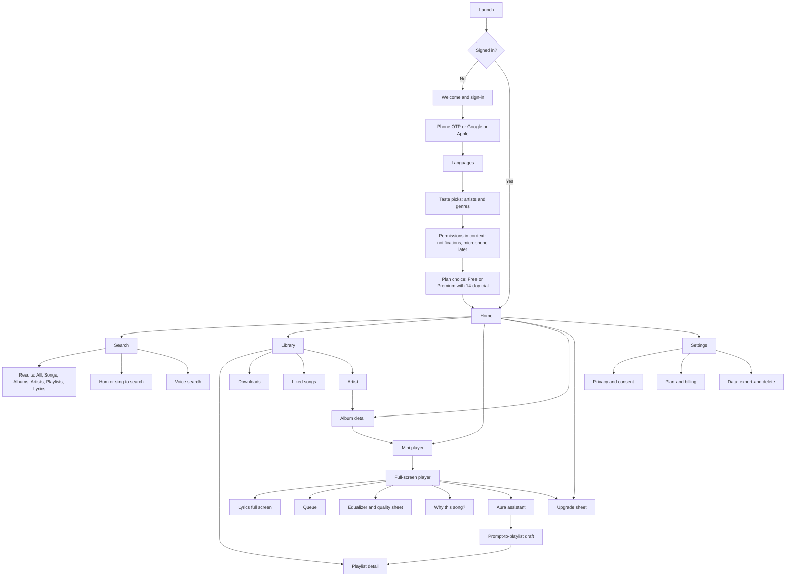

# 4. UI/UX Screen List and Navigation Flow — AuraSound

**Status:** Draft v1.0 · **Platforms:** Android and iOS (Flutter), web (Next.js), desktop (P2), car, watch, speaker (P3)

---

## 4.1 Experience principles

1. **Music first, chrome last.** The mini player is always visible while something plays. Full-screen player is one swipe away.
2. **Language is a first-class setting.** Titles, lyrics, search, and assistant responses follow the user's language and script preference. Titles can show in the original script and a transliteration.
3. **No interruptions.** No ads, no interstitials. Upgrade prompts appear only on locked features, on the Settings screen, or after a skip limit, and they never cover playback controls.
4. **Explain the AI.** Every recommendation has a "Why this?" affordance. AI-generated content has a visible label.
5. **Offline is a state, not an error.** Offline users see their library, downloads, and recent plays with clear status. No blank screens.
6. **Accessible by default.** WCAG 2.2 AA. Dynamic type to 200%. Screen-reader labels on every control. 44 × 44 pt minimum targets. Reduce-motion respected. Captions for voice responses.

---

## 4.2 Information architecture and navigation

**Primary navigation (MVP): three tabs, plus persistent player.**

| Element | Behaviour |
|---|---|
| **Bottom bar** | Home · Search · Library. Social (P2) and Live (P3) tabs are added when those phases ship |
| **Mini player** | Above the bottom bar on all tabs except full-screen flows. Shows art, title, play or pause, and a progress line. Tap to expand; swipe up to expand; swipe away to hide the queue (not the track) |
| **Full-screen player** | Expands from the mini player. Controls, lyrics toggle, queue, quality badge, Aura assistant (mic), share, and "Why this?" |
| **Aura button** | Persistent mic button on Home and Search top bars (and in the full-screen player). Tap for voice; long-press for text input |
| **Top-level actions** | Settings and profile icon at top right on Home and Library |

**Navigation rules**

- Back gesture returns to the previous screen; if the full-screen player is open, back collapses it to the mini player.
- Deep links open the target screen with the mini player and playback state preserved (`aurasound://track/{id}`, `aurasound://playlist/{id}`, `aurasound://artist/{id}`).
- Shared web links (`https://aurasound.in/...`) open the app where installed, or the web player where not.

---

## 4.3 Navigation flow

---

## 4.4 Screen inventory

Each screen lists its phase and its key states (loading, empty, error, offline). Reference states must be designed for each screen before build.

### 4.4.1 Onboarding and account

| ID | Screen | Phase | Purpose and content | States to design |
|---|---|---|---|---|
| S-01 | Welcome | MVP | Brand, one-line value proposition ("Ad-free, in your language"), sign-in options | Default, offline (sign-in disabled, message) |
| S-02 | Phone sign-in | MVP | Phone input with country code (+91 default), OTP request | Invalid number, rate limited |
| S-03 | OTP verification | MVP | 6-digit code, auto-fill, resend timer | Wrong code, expired code |
| S-04 | Social sign-in | MVP | Google and Apple sign-in sheets | Account exists with another method |
| S-05 | Language selection | MVP | Choose app and lyrics languages: Hindi, Telugu, Tamil, English (more in P2). Each option shown in its own script ("தமிழ்", "తెలుగు", "हिन्दी") | Multiple languages selected |
| S-06 | Taste picks | MVP | Grid of artists and genres for chosen languages; choose up to 10; "Skip for now" | Loading, too few picks (suggest) |
| S-07 | Permissions | MVP | Notifications (asked here); microphone is asked when the user first uses voice | Denied (explain and link to settings) |
| S-08 | Plan choice | MVP | Free vs Premium plans with regional prices, student and family options, 14-day trial | Store unavailable, price loading |
| S-09 | Ready | MVP | "Your music is ready" and the first home screen loads | — |
| S-10 | Age and parental consent | MVP | Age question; if under 18, parental consent flow | Parent verification pending |
| S-11 | Privacy notice and consent | MVP | Plain-language purposes (core, personalisation, voice, context, marketing). Each toggle separate, with "What this means" | Declined (service still works) |

### 4.4.2 Home and discovery

| ID | Screen | Phase | Purpose and content | States |
|---|---|---|---|---|
| S-20 | Home | MVP | Greeting; quick picks (6 tiles from recently played); "Made for you" rails; "Based on your languages"; new releases; charts by language; Aura entry | Loading skeleton; offline (cached rails + downloads); empty (new user: taste-based rails) |
| S-21 | Language home | MVP | Home for one language or script (Telugu, Tamil, Hindi, English), with local charts and new releases | Empty language (fallback to global) |
| S-22 | Mood and activity rails | MVP | Focus, workout, commute, sleep, rain, monsoon, wedding, festival (cultural moods) | Context unavailable (uses time of day) |
| S-23 | Charts | MVP | Top songs by region and language | Stale data banner |
| S-24 | Radio and station | MVP | Seeded radio from a track, artist, or mood; "Why this?" on each track | Not enough data |
| S-25 | Why this song? | MVP | Reason codes and a control to hide artist or track, or change taste settings | — |
| S-26 | Podcasts and audiobooks home | P2 | Shows, episodes, audiobooks, resume | Empty |
| S-27 | Insights | P2 | Monthly and yearly recap cards (swipeable stories) | Not enough listening yet |

### 4.4.3 Search

| ID | Screen | Phase | Purpose and content | States |
|---|---|---|---|---|
| S-30 | Search home | MVP | Search field, voice button, hum button, browse categories (moods, languages, genres), recent searches | Empty history |
| S-31 | Suggestions | MVP | Autocomplete as user types; script-aware matches (e.g., "Kannana" matches Tamil title in Latin letters) | No suggestions |
| S-32 | Results | MVP | Tabs: All, Songs, Albums, Artists, Playlists, Lyrics; filters by language | No results (with suggested spellings) |
| S-33 | Voice search | MVP | Listening animation, live transcript, language chip | Mic denied, no speech, offline |
| S-34 | Hum or sing to search | MVP (beta) | Record 5–15 s with a visual cue; shows candidates with confidence; "Try again" | Too quiet, no match, beta label |
| S-35 | Lyrics search | MVP | Find songs by lyric line (any script) | No match |

### 4.4.4 Playback

| ID | Screen | Phase | Purpose and content | States |
|---|---|---|---|---|
| S-40 | Mini player | MVP | Art, title, artist, play or pause, progress line | Buffering spinner, error |
| S-41 | Full-screen player | MVP | Large art, title and artist (original script and transliteration if set), progress with time, controls (shuffle, previous, play, next, repeat), quality badge (e.g., "320 kbps" or "Hi-Res"), lyrics toggle, queue, share, Why this, Aura, more | Loading, buffering, error with retry, licence blocked in region |
| S-42 | Lyrics (in player) | MVP | Synced lines with current line highlighted; tap a line to seek; original, translation, and transliteration toggles; font size | Unsynced lyrics (labelled); no lyrics ("Lyrics are not available for this track") |
| S-43 | Queue | MVP | Now playing, up next, add and remove; drag to reorder; "Play next" action from any track | Empty queue |
| S-44 | Equalizer and sound | MVP | Presets (Flat, Bass Boost, Vocal, Late Night); 5-band custom EQ; crossfade (P2); Hi-Res toggle | Hi-Res unavailable on this device |
| S-45 | Sleep timer | MVP | 15, 30, 45, 60 min or end of track | — |
| S-46 | Karaoke mode | P2 | Instrumental track, lyric scrolling, pitch guide (P3 adds scoring) | Track not licensed for karaoke |
| S-47 | Listening room | P2 | Room members, now playing, shared queue, add track, sync indicator | Connection lost, reconnecting |
| S-48 | Live stream player | P3 | Live badge, chat (P3 pilot), latency indicator | Stream not started, ended |

### 4.4.5 Library and downloads

| ID | Screen | Phase | Purpose and content | States |
|---|---|---|---|---|
| S-50 | Library | MVP | Filter chips: Playlists, Songs, Albums, Artists, Podcasts (P2), Audiobooks (P2), Downloaded; sort; grid or list | Empty library (suggest first actions) |
| S-51 | Liked songs | MVP | All liked songs, play all, shuffle, download all | Offline status per item |
| S-52 | Playlist detail | MVP | Cover, title, description, play, shuffle, add songs, edit, share, visibility | Empty playlist, shared with me |
| S-53 | Album detail | MVP | Cover, credits, track list with download status, "Play next" and "Add to queue" | Unavailable in region |
| S-54 | Artist profile | MVP | Top songs, albums, singles, related artists, follow, "Fan club" (P3) | No releases yet |
| S-55 | Downloads | MVP | Downloaded tracks, storage used, auto-download settings, licence status ("Renew when online") | Licence expired (locked), storage full |
| S-56 | Recently played | MVP | Last 90 days, grouped by day | — |
| S-57 | Create playlist | MVP | Name, description, visibility; choose "Start with Aura" (prompt-to-playlist) or empty | Name required |

### 4.4.6 Aura: assistant and prompt-to-playlist

| ID | Screen | Phase | Purpose and content | States |
|---|---|---|---|---|
| S-60 | Aura sheet (voice) | MVP | Mic animation, live transcript, reply text, suggested prompts ("Play calm music for studying"), "AI assistant" label | Listening, thinking, speaking, error |
| S-61 | Aura sheet (text) | MVP | Text chat with the same capabilities; history for the session | — |
| S-62 | Confirm action | MVP | Clear confirmation for changes to library or account ("Delete playlist X?") | — |
| S-63 | Prompt-to-playlist | MVP | Text prompt input with example prompts; generated draft with title, track list, and "Why these songs" explanation; Save, Edit, Regenerate | Generating (progress), limit reached (free tier), no match |
| S-64 | Refine draft | P2 | Follow-up chips ("More upbeat", "Fewer remixes", "More Telugu") | — |
| S-65 | Voice settings | MVP | Voice processing consent status, delete voice history, choose response language | Consent withdrawn |

### 4.4.7 Social and community (P2)

| ID | Screen | Phase | Purpose and content | States |
|---|---|---|---|---|
| S-70 | Social tab | P2 | Friend activity feed (now playing, liked, playlists), "Find friends" (contacts with permission), rooms | No friends yet (invite) |
| S-71 | Friend profile | P2 | Public playlists, recent activity (if allowed), follow or unfollow | Private profile |
| S-72 | Start or join room | P2 | Create room, enter join code, room settings (who can add) | Invalid code |
| S-73 | Activity privacy | P2 | Visibility: private, friends, public; "Stop sharing now" switch | — |

### 4.4.8 Creator Hub (P2)

| ID | Screen | Phase | Purpose and content | States |
|---|---|---|---|---|
| S-80 | Creator home | P2 | Upload status, latest analytics summary, royalties summary | Not yet a creator (apply) |
| S-81 | Apply for creator access | P2 | Identity and payout setup, KYC status | Pending, rejected (reason) |
| S-82 | Upload | P2 | Track files, metadata, credits, language, rights attestation checkbox, "AI-generated content" declaration with label preview | Processing, review, rejected (reason) |
| S-83 | Analytics | P2 | Streams, listeners, cities, saves; date range; export CSV | Data delayed (24 h) |
| S-84 | Royalties and payouts | P2 | Statements by month, line items, payout schedule, minimum threshold | No payouts yet |

### 4.4.9 Live, commerce, and fan clubs (P3)

| ID | Screen | Phase | Purpose and content | States |
|---|---|---|---|---|
| S-90 | Live tab | P3 | Upcoming concerts and livestreams; "Live now" | No events |
| S-91 | Event detail | P3 | Date, venue, tiers, seats left, refund policy | Sold out, waitlist (P3+) |
| S-92 | Checkout | P3 | Tier, quantity, payment, total with fees shown | Payment failed, held tickets expired |
| S-93 | My tickets | P3 | QR ticket with rotating code; transfer | Checked in, transferred |
| S-94 | Merch | P3 | Product grid, product detail, cart, checkout (policy-compliant) | Out of stock |
| S-95 | Fan club | P3 | Tiers, perks, join | — |
| S-96 | Tip the artist | P3 | Amount chips, message, fees disclosed | Payment failed |

### 4.4.10 Settings, privacy, and billing

| ID | Screen | Phase | Purpose and content | States |
|---|---|---|---|---|
| S-100 | Settings | MVP | Account, playback, downloads, notifications, privacy, language, accessibility, about | — |
| S-101 | Playback settings | MVP | Audio quality (Auto, Low, High, Hi-Res), data saver (cellular cap), crossfade (P2), gapless on or off (on by default) | Hi-Res needs paid plan |
| S-102 | Downloads settings | MVP | Download quality, Wi-Fi only, storage limit, auto-download favourites, delete all downloads | — |
| S-103 | Language and script | MVP | App language, lyrics language, transliteration script, translation target | — |
| S-104 | Accessibility | MVP | Text size preview, reduce motion, high contrast, screen reader hints, captions for assistant | — |
| S-105 | Privacy centre | MVP | Consent toggles with notice versions, activity visibility (P2), context signals, data download, delete account | Withdrawal confirmation |
| S-106 | Plan and billing | MVP | Current plan, renewal date, change plan, family seats, payment method, cancel (two taps), invoices | Past due (update payment) |
| S-107 | Upgrade sheet | MVP | Plan comparison with the free tier limits and the premium benefits; "Not now" always visible | Store price unavailable |
| S-108 | Help and feedback | MVP | FAQs, contact support, report a lyric error, report a recognition error | — |

### 4.4.11 Web player and companion (P2–P3)

| ID | Screen | Phase | Purpose and content |
|---|---|---|---|
| W-01 | Public artist, album, playlist pages | MVP | Server-rendered for SEO and link previews; "Open in app" banner |
| W-02 | Web player (signed-in) | MVP | Player bar, queue, library, search, lyrics; no offline mode in MVP |
| W-03 | Desktop companion (Windows, macOS) | P2 | Mini window, media keys, library sync |
| W-04 | Creator web studio | P2 | Upload and analytics for larger screens |

### 4.4.12 Car, watch, and speaker (P3)

| ID | Surface | Phase | Purpose and content |
|---|---|---|---|
| A-01 | Android Auto and CarPlay | P3 | Templates only: now playing, library lists, search by voice, recent, favourites. Follows platform driving-distraction rules. Requires CarPlay audio entitlement |
| A-02 | Wear OS and watchOS | P3 | Now playing, play and pause, next, volume, downloaded playlists; offline-first |
| A-03 | Smart speakers | P3 | Voice playback and AI DJ requests; no screen |

---

## 4.5 Key user flows (step lists)

**Flow F1: First-time user to first song (target ≤ 60 seconds, median network)**

1. S-01 Welcome → S-02 phone number → S-03 OTP.
2. S-05 Languages (pick Telugu and English) → S-06 taste picks (pick 3 artists).
3. S-08 Plan choice: Free, or Premium trial (taps "Continue free" or "Start trial").
4. S-20 Home loads with rails for chosen languages. Tap a song → playback starts within 500 ms (p50).

**Flow F2: Offline download**

1. Album detail (S-53) → "Download" → quality is chosen by setting (default High on Wi-Fi).
2. Progress shown on track rows; "Downloaded" badge when complete.
3. Offline: Library shows only downloaded content plus recent plays. Playback works without network.
4. Licence renewal: on next online launch the app renews licences silently. If expired, a banner says "Connect to renew downloads" and the tracks are locked, with no data loss.

**Flow F3: Voice command to playlist**

1. Home → Aura mic (S-60). "Play something calm for studying."
2. Assistant responds in text and voice within 1.5 s (p95), says it is an AI, and starts playback.
3. Voice feedback: "Why this?" opens the explanation.

**Flow F4: Prompt-to-playlist**

1. Create playlist → "Start with Aura" (S-57) → S-63 prompt.
2. Draft appears in ≤ 4 s (p95) with a title and "Why these songs".
3. "Save" creates playlist; "Regenerate" keeps the prompt; free tier shows remaining daily count.

**Flow F5: Hum to search (beta)**

1. Search → hum button (S-34) → 5–15 s recording with visual cue.
2. Up to 3 candidates with confidence; tap to play. "Not this one?" offers voice or text search.

**Flow F6: Lyrics with transliteration**

1. Full-screen player → Lyrics (S-42). Choose "Transliteration: Latin" and "Translation: English".
2. Current line is highlighted; tap to seek.

**Flow F7: Upgrade (free user hits a limit)**

1. Free user skips the seventh time in an hour: skip is blocked, a non-blocking sheet appears (S-107) with "Not now" and the plan comparison.
2. Playback continues on the current track; the sheet does not cover the controls.

**Flow F8: Privacy withdrawal**

1. Settings → Privacy centre (S-105) → toggle "Voice processing" off.
2. Confirmation sheet explains what stops (voice commands) and what continues (typed commands).
3. Change recorded in the consent ledger; voice button is replaced by text input.

**Flow F9: Account deletion**

1. Settings → Data (S-105) → "Delete account" → explanation of 30-day grace and what is removed.
2. Confirmation with password or OTP re-check → status shown (Pending deletion, date).
3. Sign-in within 30 days cancels deletion.

---

## 4.6 Content and language guidelines

- **Scripts:** Noto Sans family for Latin, Devanagari, Telugu, and Tamil. Line heights are increased for Indic scripts (≥ 1.5 for body text) because of conjuncts and vowel signs.
- **Titles:** show the original script first, then the transliteration in a smaller line when the user has selected one.
- **Lyrics:** keep line breaks as sung. Never auto-translate titles of songs.
- **Tone:** plain, warm, and direct. No jargon ("licence checks" becomes "Downloads renew when you're online").
- **Numbers and dates:** Indian numbering (lakh and crore) for money, and local date formats per locale.
- **Voice responses:** under 15 seconds; always offer a text alternative.

---

## 4.7 Design system and handoff

- Tokens: colour (light and dark), typography, spacing (4 pt grid), elevation, motion (durations under 300 ms; respect reduce-motion), iconography.
- Components: track row, album card, artist circle, playlist cover, mini player, full-screen player, lyric line, chip, sheet, toast, empty state, offline banner, AI label badge.
- Accessibility checks: contrast checked for every token pair in both themes; focus order documented for each screen; screen-reader labels in the component library.
- Prototype and usability tests: clickable prototype for F1–F5 tested with 12 users in Hyderabad, Chennai, and Pune before the M3 feature freeze (per [06-roadmap-and-team.md](06-roadmap-and-team.md)).
